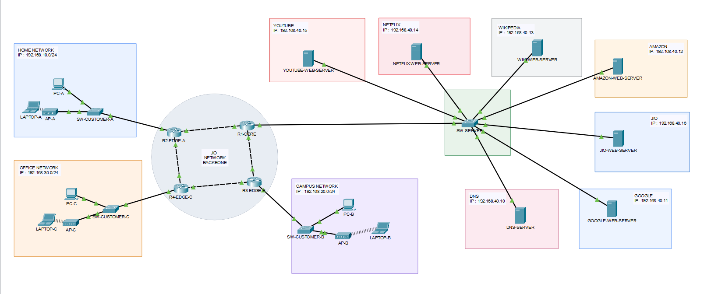
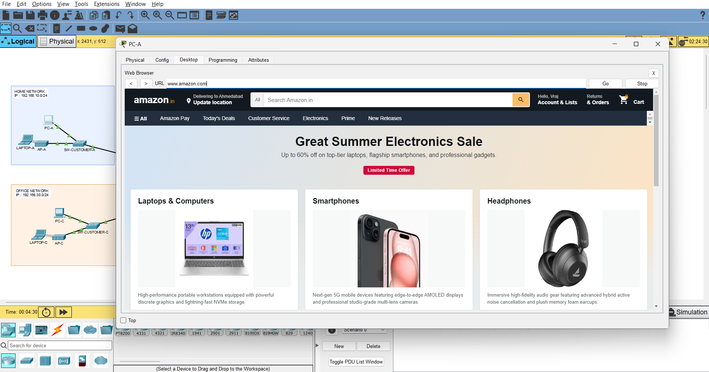
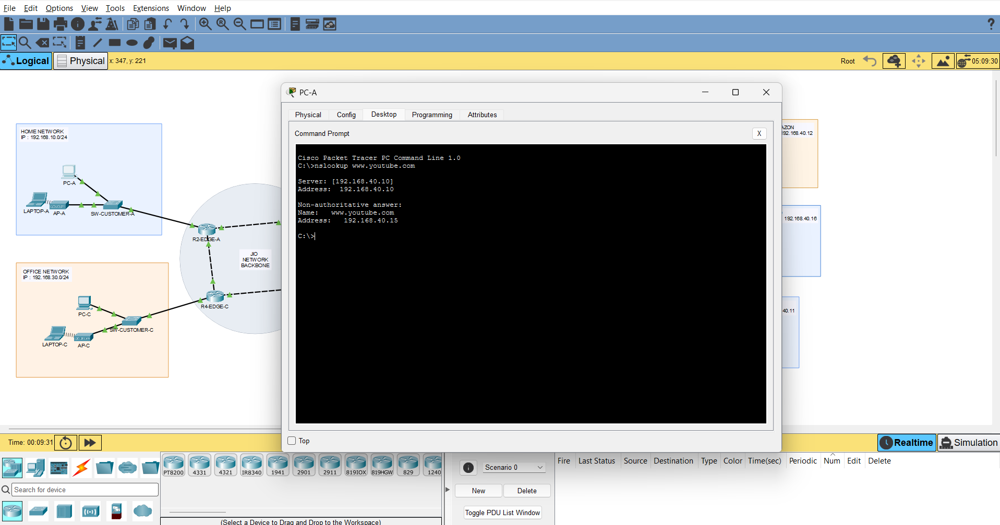

# Jio ISP Network Simulator Using Cisco Packet Tracer

<p align="center">
  <strong>A simulated Internet Service Provider network built using Cisco Packet Tracer 9.0.</strong>
</p>

<p align="center">
  
  
  
  
</p>

---

## 1. Project Overview

The **Jio ISP Network Simulator** is a computer networking project developed using **Cisco Packet Tracer 9.0**.

The project simulates an Internet Service Provider (ISP) environment in which multiple customers can connect to a network through wired and wireless connections and access locally hosted demonstration websites.

It demonstrates how an ISP can provide network connectivity, dynamically assign IP addresses, resolve domain names, manage website access, and maintain connectivity through alternative routing paths.

The project uses a Jio-inspired theme to represent an ISP service environment.

## 2. Problem Statement

When a customer purchases a new device, such as a laptop, the device cannot access online services without a working network connection.

An ISP provides the connectivity and network services required for customers to access websites and other network resources.

This project simulates that process by connecting customer devices to a Jio-themed ISP network and demonstrating how network services work together to provide website access.

## 3. Project Objectives

- Design an ISP-style network using Cisco Packet Tracer.
- Connect multiple customer networks through routers.
- Support both wired PCs and wireless laptops.
- Configure dynamic IP address allocation using DHCP.
- Configure domain name resolution using DNS.
- Enable access to locally hosted demonstration websites.
- Implement dynamic routing using OSPF.
- Demonstrate network address translation using NAT.
- Control customer website access using extended ACLs.
- Demonstrate alternative routing during network link failure.
- Explore traffic prioritization using QoS, where configured and verified.

## 4. Technologies and Devices Used

| Category | Technology / Device |
|---|---|
| Simulation software | Cisco Packet Tracer 9.0 |
| Routers | Cisco 2911 |
| Routing | OSPF |
| IP allocation | DHCP |
| Name resolution | DNS |
| Web service | HTTP |
| Access control | Extended ACL |
| Address translation | NAT |
| Wireless connectivity | Wireless Access Point |
| End devices | PCs and laptops |
| Switching | Ethernet switches |

## 5. Network Architecture

The project is organized into three main areas:

### ISP Core Network

The ISP router network connects the different customer networks and server network. OSPF allows participating routers to exchange routing information.

### Customer Networks

Multiple customer networks are connected to the ISP.

Customers can connect through:
- Wired PCs connected using Ethernet cables and switches.
- Wireless laptops connected through access points.

### ISP Server Network

The server network provides services such as DNS and HTTP.

The DNS server resolves configured domain names, while the HTTP server or servers host locally simulated demonstration websites.

## 6. Network Addressing

The following is the project's example addressing plan:

| Network | Network Address |
|---|---|
| Customer A | `192.168.10.0/24` |
| Customer B | `192.168.20.0/24` |
| Customer C | `192.168.30.0/24` |
| ISP Server Network | `192.168.40.0/24` |

Example DNS server address:

`192.168.40.10`

> Verify the final addressing plan against the saved Packet Tracer topology before making configuration changes.

## 7. Key Features

### 7.1 Wired Customer Connectivity

Customers can connect PCs to customer switches using Ethernet cables and access ISP services.

### 7.2 Wireless Customer Connectivity

Laptops can connect to the network through wireless access points using a configured SSID and wireless security settings.

### 7.3 DHCP — Automatic IP Allocation

DHCP automatically assigns IP addresses and other network settings to customer devices.

### 7.4 DNS — Domain Name Resolution

DNS converts configured website domain names into IP addresses.

Example:

`www.youtube.com` → `192.168.40.15`

The IP shown is an example. Refer to the actual DNS record in the Packet Tracer project.

### 7.5 HTTP — Website Hosting

The project includes locally simulated website pages for:

- Google
- YouTube
- Amazon
- Netflix
- Wikipedia
- Jio

These websites are demonstration pages hosted within the Packet Tracer environment, not the actual external websites.

### 7.6 OSPF — Dynamic Routing

OSPF enables routers to exchange routing information and learn available network paths.

### 7.7 NAT — Network Address Translation

NAT demonstrates how IP addresses can be translated between network domains.

### 7.8 ACL — Website Access Control

Extended ACL rules allow the ISP administrator to control selected customer traffic.

For example, an administrator can block Customer B from reaching the YouTube demonstration server while allowing other permitted traffic.

### 7.9 Network Recovery

The project demonstrates alternative routing when a primary network link fails, provided an alternative route is available.

### 7.10 QoS — Quality of Service

QoS can classify and prioritize selected network traffic. A Basic-versus-Premium demonstration is included only if the corresponding policy is configured and verified in the final project.

## 8. Project Screenshots

The following screenshots demonstrate the major project functions.

### 8.1 Network Topology



### 8.2 Website Access



### 8.3 DNS Resolution



### 8.4 Wireless Connectivity


## 9. Project Folder Structure

```text
Jio-ISP-Project/
│
├── README.md
├── LICENSE
├── .gitignore
│
├── Packet-Tracer/
│   └── ISP-Network-Simulator.pkt
│
├── Website-Assets/
│   ├── Amazon/
│   │   ├── index.html
│   │   └── [Image files]
│   ├── YouTube/
│   │   ├── index.html
│   │   └── [Image files]
│   ├── Google/
│   │   ├── index.html
│   │   └── [Image files]
│   ├── Netflix/
│   │   ├── index.html
│   │   └── [Image files]
│   ├── Wikipedia/
│   │   ├── index.html
│   │   └── [Image files]
│   └── Jio/
│       ├── index.html
│       └── [Image files]
│
├── Screenshots/
│   ├── 01-network-topology.png
│   ├── 02-website-access.png
│   ├── 03-dns-resolution.png
│   └── 04-wireless-connectivity.png
│
└── Documentation/
    ├── Network-Configuration.md
    ├── Adding-New-Customer.md
    └── ACL-Guide.md
```

Each website has its own folder containing `index.html` and its related image files in the same directory. The HTML pages use internal CSS.

## 10. How to Run the Project

1. Install Cisco Packet Tracer 9.0.
2. Clone or download this GitHub repository.
3. Open the `Packet-Tracer` folder.
4. Open `ISP-Network-Simulator.pkt` in Cisco Packet Tracer.
5. Wait for the network topology to load.
6. Check router, switch, server, and access point connectivity.
7. Test a customer device's IP configuration.
8. Test DNS resolution.
9. Open a configured demonstration website using the customer device's web browser.

## 11. Configuration and User Guides

Detailed instructions are available in the `Documentation` folder.

| Guide | Description |
|---|---|
| [Network Configuration](Documentation/Network-Configuration.md) | Network architecture, services, addressing and verification commands |
| [Adding a New Customer](Documentation/Adding-New-Customer.md) | Step-by-step wired and wireless customer/device connection |
| [ACL Guide](Documentation/ACL-Guide.md) | Commands and examples for allowing, blocking and restoring website access |

## 12. Limitations

- The project is an educational simulation, not a production ISP network.
- The demonstration websites are locally hosted sample pages.
- The simulation does not provide real public internet connectivity.
- Packet Tracer may simplify the behavior of some real-world network services.
- Website access rules in the project use IP-based ACL filtering rather than a full domain-aware web filtering system.

## 13. Future Enhancements

- Improve customer management and network monitoring.
- Expand the number of customer networks.
- Add more network security policies.
- Improve QoS configuration and verification.
- Add more demonstration services and websites.

## 14. License

This project is distributed under the MIT License for the original work included in this repository.

See the [LICENSE](LICENSE) file for details.

Cisco Packet Tracer and third-party trademarks, images, and assets remain the property of their respective owners. Their inclusion does not imply endorsement.

## 15. Author

**Developed as an educational Computer Networking project.**

Project: Jio ISP Network Simulator Using Cisco Packet Tracer

Software: Cisco Packet Tracer 9.0